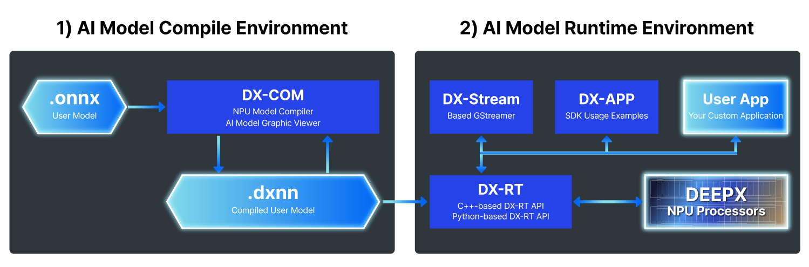

<div align="center">

# DX-Runtime

**Everything a target needs to run models on DEEPX NPUs: driver, firmware, runtime, apps and streaming.**

[](https://github.com/DEEPX-AI/dx-runtime/releases)
[](https://developer.deepx.ai/tech-docs/DX-AllSuite/Setting_Up_Environment/)

</div>

<div align="center">
  <picture>
    <source media="(prefers-color-scheme: dark)" srcset="./docs/source/img/dxnn_sdk_illustration_simple-dark.png">
    
  </picture>
</div>

DX-Runtime is the target-side bundle of the DXNN® SDK. It brings the five components that run `.dxnn` models
on a DEEPX NPU together as Git submodules, with one installer that sets them up at versions tested together.
It is part of [DX-AllSuite](https://github.com/DEEPX-AI/dx-all-suite), which adds the compiler on the host side.

| Component | What it does | Source |
|---|---|---|
| **NPU Driver** | Linux kernel driver (`dxrt_driver`, `dx_dma`) | [`dx_rt_npu_linux_driver`](https://github.com/DEEPX-AI/dx_rt_npu_linux_driver) |
| **DX-FW** | Firmware images for DEEPX NPUs | [`dx_fw`](https://github.com/DEEPX-AI/dx_fw) |
| **DX-RT** | Runs `.dxnn` models from C++ or Python; `dxrun` and `dxcli` tools | [`dx_rt`](https://github.com/DEEPX-AI/dx_rt) |
| **DX-APP** | Ready-to-run C++ and Python AI applications | [`dx_app`](https://github.com/DEEPX-AI/dx_app) |
| **DX-STREAM** | GStreamer elements for building Vision AI pipelines | [`dx_stream`](https://github.com/DEEPX-AI/dx_stream) |

## What You Need

| | |
|---|---|
| **Arch** | x86_64, aarch64 |
| **OS** | Ubuntu 20.04 / 22.04 / 24.04 / 26.04 LTS, Debian 12 / 13 |
| **NPU** | DX-M1, DX-M1M or DX-H1 Quattro |

On Windows 10 22H2 or later (x64), install DX-RT with the Windows SDK installer instead →
[DX-RT](https://github.com/DEEPX-AI/dx_rt)

## Quick Start

```bash
git clone --recurse-submodules https://github.com/DEEPX-AI/dx-runtime.git
cd dx-runtime
./install.sh --all          # driver, firmware, DX-RT, DX-APP and DX-STREAM
sudo reboot                 # once, to load the NPU driver

dxcli -s                    # check the NPU
```

Only need to run models, without the apps and GStreamer plugin? Use `./install.sh --runtime-only` to install the
driver, firmware and DX-RT. Then continue with [DX-APP](https://github.com/DEEPX-AI/dx_app) or
[DX-STREAM](https://github.com/DEEPX-AI/dx_stream) to run your first examples.

<details>
<summary><b>Install Options, Uninstall</b></summary>

```bash
./install.sh --target=dx_rt,dx_app           # only the listed components
./install.sh --all --exclude-fw              # everything except firmware
./install.sh --all --driver-source-build     # build the driver from source instead of DKMS
./install.sh --all --rt-source-build         # build DX-RT from source instead of the Debian package
./install.sh --help                          # all options

./uninstall.sh                               # remove all components (or --target=dx_rt, dx_app, ...)
```

`--exclude-driver`, `--exclude-rt`, `--exclude-app` and `--exclude-stream` work like `--exclude-fw`.
Firmware already flashed to the NPU is not reverted on uninstall.

</details>

<details>
<summary><b>Other Ways to Install: one-line, APT, Docker</b></summary>

**One-line install** — driver, DX-RT and firmware from prebuilt binaries, no clone needed. It does not install
DX-APP or DX-STREAM.

```bash
curl -fsSL https://raw.githubusercontent.com/DEEPX-AI/dx-runtime/main/oneline-install.sh | sh
```

It tracks the newest published build of each component, which may be a combination that has not been tested
together. Pin versions with `DX_RT_VERSION`, `DX_DRIVER_VERSION` and `DX_FW_VERSION`
(e.g. `curl -fsSL ... | DX_RT_VERSION=3.5.0 sh`), or use `install.sh` for a tested set. Remove it with
`oneline-uninstall.sh` from the same URL.

**APT repository** — the driver and DX-RT as Debian packages (`amd64`, `arm64`), upgraded with `apt`. Firmware,
DX-APP and DX-STREAM are not included.

```bash
wget -O deepx-archive-keyring.asc https://apt.releases.deepx.ai/gpg
gpg --show-keys deepx-archive-keyring.asc   # fingerprint must be 3A20CC853C64AE328D0F58CFD816AAC6689DBDEA
sudo gpg --dearmor -o /usr/share/keyrings/deepx-archive-keyring.gpg deepx-archive-keyring.asc
rm deepx-archive-keyring.asc

echo "deb [arch=$(dpkg --print-architecture) signed-by=/usr/share/keyrings/deepx-archive-keyring.gpg] https://apt.releases.deepx.ai $(. /etc/os-release && echo "${UBUNTU_CODENAME:-$VERSION_CODENAME}") main" | sudo tee /etc/apt/sources.list.d/deepx.list

sudo apt update
sudo apt install dxrt-driver-dkms libdxrt-bin
```

If the fingerprint does not match, stop and do not install the key. The `dx_engine` Python wheels are in
`/usr/share/libdxrt-bin/python/`. Update the firmware with `./install.sh --target=dx_fw`.

**Docker** — prebuilt `dx-runtime` images for amd64 and arm64 →
[Docker Guide](https://github.com/DEEPX-AI/dx-all-suite/blob/main/docker/README.md)

Details for every route → [Setting Up Environment](https://developer.deepx.ai/tech-docs/DX-AllSuite/Setting_Up_Environment/)

</details>

## Documentation & Support

- Installation guide: **[Setting Up Environment](https://developer.deepx.ai/tech-docs/DX-AllSuite/Setting_Up_Environment/)** · [Release Notes](./RELEASE_NOTES.md)
- For technical questions, please ask in the DEEPX Developer Community: https://community.deepx.ai/c/support/5

## License

See [LICENSE](./LICENSE) for terms of use.

Copyright © DEEPX Co., Ltd.
